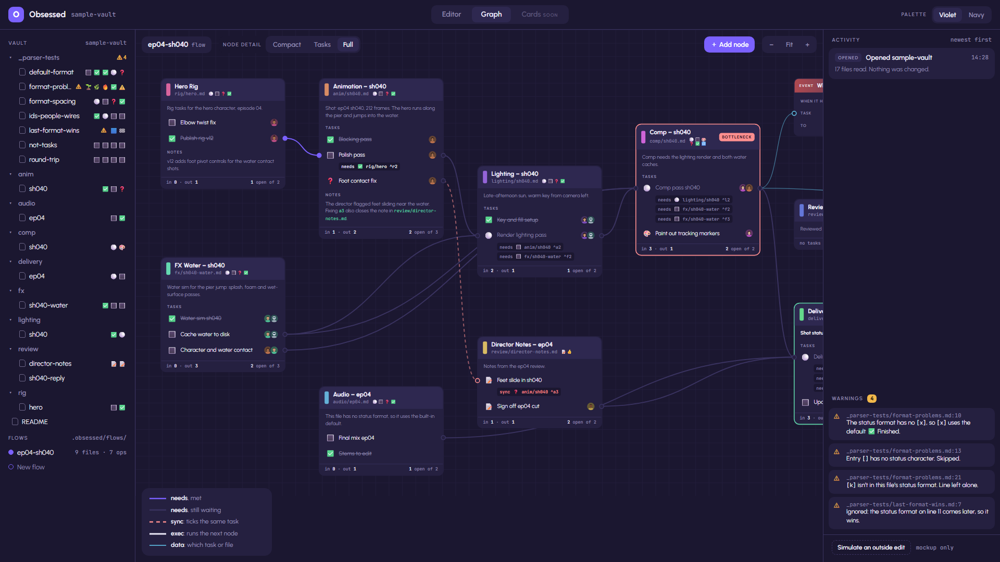
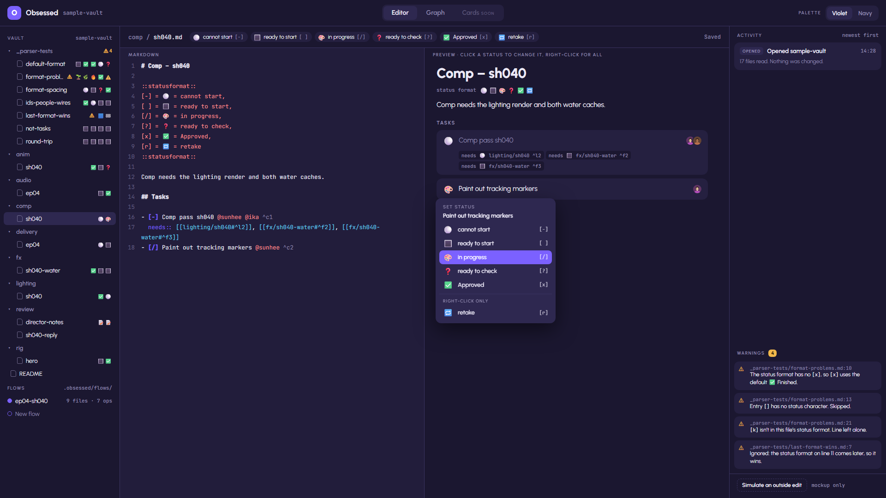
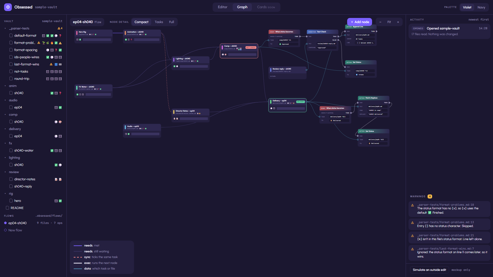
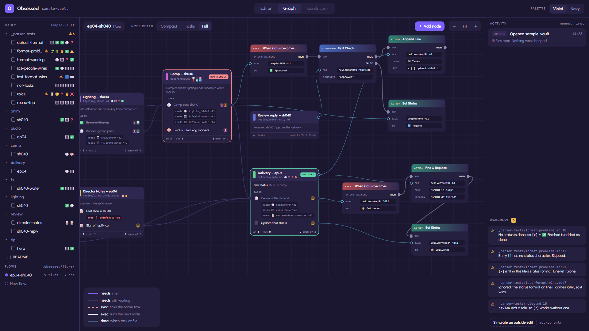
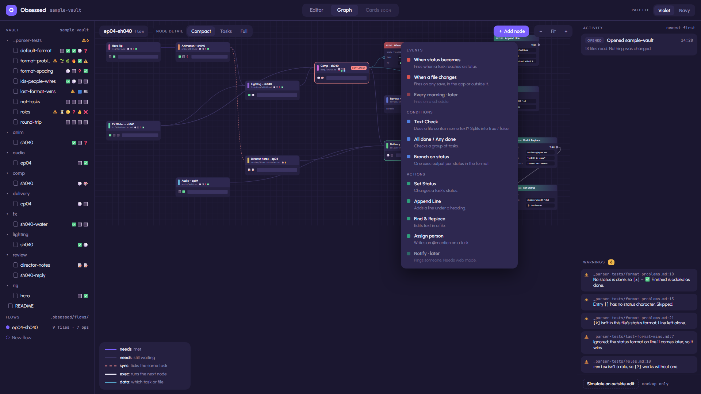
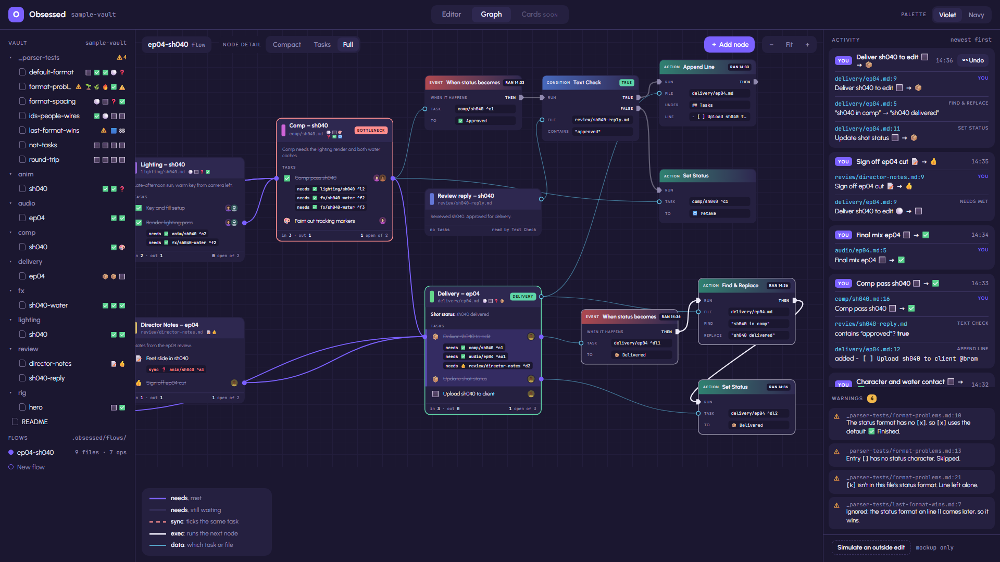
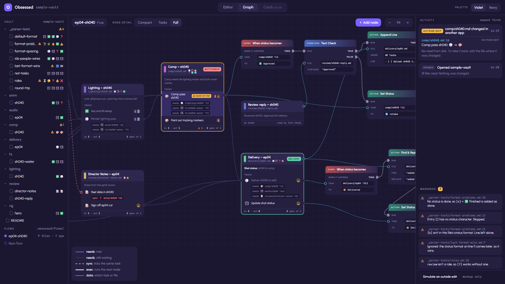

# Obsessed – Plan

A markdown task app for creative teams, built in Godot.

Like Obsidian, your notes are plain `.md` files in a folder. What's different is the **node graph**: every `.md` file is a node, every task is a row with pins, and wires carry status between files the way a studio pipeline does. When animation marks a shot approved, lighting's task for that shot becomes ready to start, by itself.

On top of that sits a **card layer** inspired by Balatro: tasks are the enemies, and your hand holds crew cards and tool cards.

> Updated 2026-10-15. Replaces the old `Project-Plan.md` and `Detailed-Plan.md`.

## Ground rules

1. **The files are the truth.** Everything the app knows is written in plain markdown, following [SYNTAX.md](SYNTAX.md). The graph and the cards are views of those files. Close the app and the vault still makes sense in Obsidian.
2. **Desktop first, web later.** It's one Godot project. The UI only talks to a `Vault` interface, so web mode means adding a second implementation, not rewriting the app.
3. **This is a learning project.** All GDScript and scenes are written by hand. AI help is for planning, explaining and reviewing.
4. **The game layer sits on top.** Every card play becomes an ordinary markdown change, so turning cards off loses nothing.

## The screens

> These images are rendered from the HTML mockups in `docs/mockups/`. They're ideation, so details will change. To regenerate them after editing a mockup, run `bash docs/mockups/render-screens.sh` in Git Bash.
>
> The first sections come from the full-app mockup, `obsessed-app.html`. It reads its content from `sample-vault/` (a check confirmed its file output matches the vault exactly) and follows SYNTAX.md, including statuses, chain reactions and undo. It's clickable, so open it in a browser and try it. The sections from [Flow view](#flow-view) on come from the two earlier mockups.

### Main layout

The whole app in one window, like Obsidian: the vault on the left, the current view in the middle, and what the app has done on the right.



| Piece | What it does | Godot to look at |
|---|---|---|
| Top bar | Switches between **Editor**, **Graph** and (later) **Cards**. The palette toggle sits on the right. | `TabBar`, or `Button`s in a `ButtonGroup` |
| Vault tree | Folders and files. Each file shows its tasks as a row of status emoji, plus ⚠ if it has problems. | `Tree` with two columns: the name, and the emoji strip as text |
| Flows | Saved graphs. A flow picks which files appear in the graph and holds its operator nodes. Saved in `.obsessed/flows/`. | More `Tree` items, or an `ItemList` |
| Center | The current view. | A `TabContainer` with its tabs hidden, or show and hide the views yourself |
| Activity | Everything the app changed, newest first, with Undo. See [Chain reactions and the log](#chain-reactions-and-the-log). | `ScrollContainer` + `VBoxContainer` |
| Warnings | Problems found while reading files. Click one to jump to its line. | The same, with one `Button` per warning |
| Columns | Three resizable columns. | Two nested `HSplitContainer`s |

### Editor and statuses

The raw markdown is on the left and a live preview on the right. The chips along the top are this file's own `::statusformat::`, and `comp/sh040.md` adds 🎨 in progress and 🔁 retake. Right-clicking a status opens the picker:
- ⚪ is greyed out because this task's `needs::` wires control it.
- 🔁 retake sits under "Right-click only" because it comes after ✅ in the format, so clicking never lands on it.

The Warnings list shows the four problems planted in `_parser-tests/`.



| Piece | Godot to look at |
|---|---|
| Markdown pane with line numbers and colors | `CodeEdit` (`gutters_draw_line_numbers`) with a `SyntaxHighlighter`. `CodeHighlighter` can color regions like `::statusformat::`. For the rest, extend `SyntaxHighlighter` and override `_get_line_syntax_highlighting()`. |
| Lines changed by wires | `TextEdit.set_line_background_color()` |
| Preview | Headings and paragraphs can be `RichTextLabel`s (milestone 8). Make each task row its own scene, so the status is a real `Button` you can click. |
| Status chips | `HFlowContainer` with small `PanelContainer`s |
| Status picker | `PopupMenu`: `add_item()`, `add_separator("Right-click only")`, `set_item_disabled()` |

### Node detail levels

Each file node can show more or less of its file:
- **Full** (the picture under [Main layout](#main-layout)) shows headings, notes and the `needs::` chips. The node header also shows the file's status format, so you can see at a glance which statuses it uses.
- **Tasks** shows only the task rows.
- **Compact** shrinks each file to one line of status emoji and a progress bar. That's how a whole flow fits on one screen:



Godot: show or hide the node's children for each level, then call `reset_size()` on the `GraphNode` so it shrinks. You could also switch levels automatically by reading `GraphEdit.zoom`.

### Operator nodes

These are Blueprint-style nodes that aren't files. Red means event, blue means condition, green means action. White ▶ pins and wires are **exec** (what runs next). Blue ● pins are **data** (which task or file).



The ep04-sh040 flow has two small chains:
1. **When** *Comp pass sh040* becomes ✅ → **Text Check**: does `review/sh040-reply.md` contain "approved"?
   - *true* → **Append Line** `- [ ] Upload sh040 to client @bram` under `## Tasks` in `delivery/ep04.md`.
   - *false* → **Set Status**: send *Comp pass sh040* to 🔁 retake.
2. **When** *Deliver sh040 to edit* becomes 📦 → **Find & Replace** "sh040 in comp" with "sh040 delivered" in `delivery/ep04.md` → **Set Status** *Update shot status* to 📦.

| Piece | Godot to look at |
|---|---|
| Pins | `GraphNode.set_slot()`. Give exec, task and file pins different slot types. `GraphEdit` only connects matching types unless you call `add_valid_connection_type()`, so nobody can plug a file into an exec pin. Use `custom_icon_left` / `custom_icon_right` for the ▶ shape. |
| Colored headers | The `GraphNode`'s `titlebar` theme style box |
| Fields | `LineEdit` or `OptionButton` inside the node's rows |
| TRUE / RAN pills | `Label` with a `StyleBoxFlat` |

### Adding nodes



Grey items marked "later" need something that doesn't exist yet, like a scheduler or web mode. Godot: `GraphEdit` emits `popup_request` when you right-click the canvas, so the same menu can open there too.

### Chain reactions and the log

Here every task from rig to delivery has been ticked: the full run from milestone 5. Each click starts a **chain**, and the Activity panel lists every change in it, with file and line.
- Approving comp ran the first operator chain. Text Check returned TRUE, so the upload task was added to delivery.
- Delivering ran the second. The shot status line now says "sh040 delivered", and *Update shot status* is 📦.
- The exec wires that ran in the newest chain are bright white.



**Undo** only appears on the newest chain, and it undoes the whole chain at once. Press it again to undo the chain before.

Godot: `UndoRedo` does this. Make one action per chain with `create_action()`, add a do and an undo method for each change, then call `commit_action()`. For the bright wires, look at `GraphEdit.set_connection_activity()`.

### Outside edits and warnings

Here someone set *Comp pass sh040* to 🎨 in progress in Obsidian, before lighting and FX were done. The app re-reads the file and logs it as an **Outside edit**. There's no Undo, because the app didn't make the change. It also flags the task four ways: a yellow node border, a "⚠ needs not met" badge, ⚠ in the tree, and a new entry under Warnings.



Godot: use a `Timer` that compares `FileAccess.get_modified_time()` for each file. Clicking a warning opens the file and moves the cursor there with `set_caret_line()`.

### Flow view

This is the first mockup, `obsessed-flow.html`, made before status formats existed. Every `.md` file is a node, every task is a row, and wires show what waits on what.


| Piece | What it does | Godot to look at |
|---|---|---|
| Top bar | App name, the current flow, and toggles for node content (Tasks / Markdown), palette, and hand raised or tucked. | `HBoxContainer`; `Button` with `toggle_mode` and a `ButtonGroup` for each set of toggles |
| Canvas | Pan, zoom, and a grid behind the nodes. | `GraphEdit` (panning, zoom, grid, snapping and a minimap are built in) |
| Legend | Explains the wire colors and the pills. | `PanelContainer` + `VBoxContainer` + `Label` |
| Zoom − Fit + | Zoom out, fit everything on screen, zoom in. | `GraphEdit`'s built-in menu has zoom buttons. "Fit" is your own math on `zoom` and `scroll_offset`. |
| File node | One `.md` file. The color strip is the department, followed by the title and file path. | `GraphNode`. Add extra things to its title bar with `get_titlebar_hbox()`. |
| Pill | BOTTLENECK: 3+ wires in, still open, work waiting downstream. DELIVERY: 3+ wires in, nothing after it. | `Label` with a `StyleBoxFlat` (rounded corners, background color) |
| Task row | Status box, task text, people. | `HBoxContainer` inside the `GraphNode` |
| Pins | The dots on a row's left (in) and right (out) edges. | `GraphNode.set_slot()` turns a row's edges into ports |
| Wires | Solid purple = live (upstream done). Grey = waiting. Dashed pink = `sync::`. | `GraphEdit` connections, colored by their slots. Dashed lines aren't built in: draw sync wires yourself or give them their own color. |
| Node footer | `in 3 · out 1` and `2 open of 2`. | `Label`, updated whenever the file changes |
| Text Check | The first operator node. It fires when comp is done and the reply note contains "approved". | Another `GraphNode`, with a `LineEdit` inside |
| Crew hand | Cards along the bottom. See [Card hand](#card-hand). | |

### A file as a node

The **Markdown** toggle shows the same nodes as the plain text that's really in each file. It's ground rule 1 in one picture: the graph is only a view of the markdown.


> The flow and hand mockups were made before [`::statusformat::`](SYNTAX.md#2-status-format), so they show a plain checkbox and lock. The full-app mockup above shows each file's own symbols (⚪ 🔳 ❓ ✅ …).

### Firing wires

This is the vertical slice from milestone 4. Ticking *Polish pass* (anim) and *Cache water to disk* (fx) makes their wires go live, and *Render lighting pass* (lighting) unlocks: its lock icon is gone in the "after" picture.

| Before | After |
|---|---|
|  |  |

In the real app the file changes too. `lighting/sh040.md` goes from `- [-] Render lighting pass` to `- [ ] Render lighting pass`, so ⚪ becomes 🔳.

### Crew spotlight

Hovering a crew card dims every task that person isn't on, so you can see at a glance how spread out someone is. Ika has 4 open tasks across 3 files, so her card says OVERLOADED.


Godot: lower the `modulate` alpha of the rows and nodes that don't match.

### Card hand

This is the single-note view: one file's tasks in the middle and the crew hand at the bottom. Click a card to pick it up (it rises and the hint changes to "Assign Ika Putri to a task"), then click a task, or drag the card onto a task. The assignment is saved as `@ika` on the task line.

| Hand | Card picked up |
|---|---|
|  |  |

| Piece | What it does | Godot to look at |
|---|---|---|
| Hand | Cards fanned in a slight arc. "Tucked" slides them mostly off screen until you hover. | A plain `Control` that places each card in code (position, rotation). Containers can't make a fan. |
| Card | Name, skill chips, portrait, status (available, busy or away), role, load pips. | `PanelContainer` + `VBoxContainer`, a `TextureRect` for the portrait, small `Panel`s for the pips |
| Load pips | One lit pip per open task, up to 4. They turn pink when the card is OVERLOADED. | |
| Hover | The card rises, straightens and tilts toward the mouse. | `Tween` on `position`, `rotation` and `scale`. The 3D tilt needs a shader. |
| Idle bob | Cards float gently. | A looping `Tween` or an `AnimationPlayer` |
| Drag onto a task | Assigns the person. | `_get_drag_data()` + `set_drag_preview()` on the card; `_can_drop_data()` + `_drop_data()` on the task row |
| Roster button | Draws another card from the roster. The hand holds at most 8. | `Button` |
| × on a card | Sends the card back to the roster. | |

### Skins and palettes

| Low-poly card skin | Navy palette |
|---|---|
|  |  |

Godot: each palette is a `Theme` resource that you can swap at runtime. A second card skin can be its own card scene or a theme variation.

### Not in the mockups yet

These parts of the idea don't have a picture yet. They're worth sketching before their milestone starts:

- **Drawing a wire by hand:** dragging from a pin to a task writes `needs::` into the file and adds a `^id` if the task needs one. (Milestone 5)
- **Retakes:** sending an approved task back. Right-click → 🔁 retake already works in the full-app mockup, but there's no picture of it yet. (Milestone 5)
- **The Cards tab:** the card hand inside the main layout. For now it only exists in its own mockup, [Card hand](#card-hand). (Milestone 7)
- **The Balatro layer:** enemies with HP, a Jokers row for always-on automations, boss blinds. (Milestone 7 onwards)

## Tech

| Part | Choice |
|---|---|
| Engine | Godot 4.7, GDScript, Compatibility renderer (web export needs it) |
| Desktop file access | `FileAccess` and `DirAccess`. No server, no Python. |
| Web mode server | Python + FastAPI (milestone 9 only) |
| Hosting | One Docker container (milestone 9 only) |

## Architecture

```
                 ┌─ LocalVault  → FileAccess / DirAccess                      desktop .exe
Views ─► Vault ──┤
   ▲             └─ RemoteVault → HTTPRequest → FastAPI → vault/ on server    web export
   │
   └── Parser + Wire engine   (logic only, no UI nodes)
```

| Piece | Job |
|---|---|
| `Vault` | List, read, write and delete files. Later: notice when files change. |
| `LocalVault` | Reads the folder on disk directly. Used by the desktop app. |
| `RemoteVault` | Asks the server over HTTP. Used by the web export, because browsers can't touch the disk. |
| Parser | Turns a `.md` file into tasks and writes single-line changes back. |
| Wire engine | Works out `needs::` and `sync::`, runs chain reactions, guards against loops, keeps the log and undo. |
| Views | File tree, editor, graph and card hand. They show what the parser and engine know, and ask the `Vault` to save changes. |

The parser and wire engine contain no UI nodes. That means you can test them on their own, and web mode can reuse them unchanged. In Unreal terms, `Vault` is an interface with two implementations.

## Repo layout

```
Obsessed/
├─ project.godot      # the Godot project lives at the repo root
├─ PLAN.md            # this file
├─ SYNTAX.md          # the markdown rules (the contract)
├─ sample-vault/      # test notes to develop against
├─ docs/
│  ├─ mockups/        # HTML mockups: obsessed-app (full app), obsessed-flow, obsessed-hand + render-screens.sh
│  └─ images/         # PNGs of the mockups, shown in this plan
└─ backend/           # FastAPI server, added in milestone 9
```

How you organise scripts and scenes is up to you. The Godot docs suggest grouping by feature, with each scene and its script side by side (for example `graph/file_node.tscn` next to `graph/file_node.gd`), instead of separate `scenes/` and `scripts/` folders.

## Milestones

Each milestone has a "done when" so you know when to move on.

### 1. Prep (done 2026-10-15)

PLAN.md, SYNTAX.md, sample-vault and the mockups are all in the repo.

### 2. Files

Goal: browse and edit the vault.

**Looks like:** [Main layout](#main-layout) and [Editor and statuses](#editor-and-statuses).

- **First:** open the project in Godot 4.7 and let it upgrade `project.godot`.
- Main layout: file tree on the left, editor on the right.
- The borderless window is off for now, so Windows draws the normal title bar. Turning it back on is in milestone 8.
- Check emoji rendering early. A browser has no system fonts, so bundle a color emoji font (for example Noto Color Emoji) as a fallback font in your Theme.
- **Learn:** containers (`HSplitContainer`, `VBoxContainer`), `Tree`, `TextEdit`/`CodeEdit`, `FileDialog`, `FileAccess`, `DirAccess`, signals, Themes.
- **Bricks.** Do one at a time and tick it off when it works. A small git commit after each brick is a good habit.
  - [ ] 1. First scene: a `Main` scene that fills the window and runs with F5
  - [ ] 2. Three-column layout from containers, with placeholder panels only
  - [ ] 3. First script: `_ready()`, `print()` and the Output panel
  - [ ] 4. List the vault's folders and files with `DirAccess`
  - [ ] 5. Show them in a `Tree`
  - [ ] 6. Click a file to open it in a `CodeEdit` (your first signal)
  - [ ] 7. Save with Ctrl+S (`FileAccess`, input actions)
  - [ ] 8. Pick any vault folder with a `FileDialog`, and remember it next time
  - [ ] 9. Emoji: a color emoji font as a fallback in a `Theme`
- **Done when:** you can pick `sample-vault/`, see its folders in the tree, open `anim/sh040.md`, edit and save it, and see the change in another editor. The emoji show in color.

### 3. Task parser

Goal: turn a `.md` file into task data, and back again.

**Looks like:** the four parser-test problems under Warnings in [Editor and statuses](#editor-and-statuses).

- Read tasks, the status format, `@people`, `^ids`, `needs::` and `sync::` as described in SYNTAX.md.
- Change one task's status and write the file back with every other character untouched.
- **Learn:** `RegEx`, `String` methods, your own classes (`class_name`, `RefCounted`), Arrays and Dictionaries, unit tests (the GUT or gdUnit4 addon).
- **Done when:** every file in `sample-vault/_parser-tests/` gives the result its "Expected" note describes, and reading then writing a file without changes gives back exactly the same bytes.

### 4. Vertical slice ⭐

Goal: prove the core idea works.

**Looks like:** [Firing wires](#firing-wires) and [Node detail levels](#node-detail-levels).

- A `GraphEdit` canvas. Each `.md` file is a `GraphNode` and each task is a row with ports.
- Draw the `needs::` wires the files describe.
- Ticking a task unblocks the tasks downstream of it, and the change is saved to disk.
- **Learn:** `GraphEdit`, `GraphNode` slots (`set_slot`), the `connection_request` signal, building UI from code.
- **Done when:** in the sample vault, ticking *Polish pass* (anim) and *Cache water to disk* (fx) flips *Render lighting pass* from ⚪ to 🔳, both in the graph and in `lighting/sh040.md`.

### 5. Wire engine

**Looks like:** [Chain reactions and the log](#chain-reactions-and-the-log) and [Outside edits and warnings](#outside-edits-and-warnings).

- `sync::` wires, custom statuses, clicking and right-click to change status, chain reactions, loop guard, log and undo.
- Drawing a wire in the graph writes `needs::` or `sync::` into the file, and adds a `^id` if the task doesn't have one.
- Notice edits made outside the app by checking `FileAccess.get_modified_time()`.
- **Done when:** the whole sh040 chain can be pushed from rig to delivery in the graph, undo works, and editing a file in Obsidian or VS Code updates the graph.

### 6. Operator nodes

**Looks like:** [Operator nodes](#operator-nodes) and [Adding nodes](#adding-nodes).

- Nodes that aren't files: events, conditions and actions (Text Check, Find & Replace, Set Status, Append Line, and so on).
- Design the `.obsessed/flows/` JSON format: which files are in a flow, where each node sits, the operator nodes and their exec wires.
- **Learn:** `GraphNode` slot types and custom pin icons, `GraphEdit.add_valid_connection_type()`, the `popup_request` signal, saving and loading with `JSON`.
- **Done when:** both chains in the ep04-sh040 flow behave as in [Chain reactions and the log](#chain-reactions-and-the-log). Approving comp adds the upload task to delivery, or sends comp to 🔁 retake if the reply doesn't say "approved". Delivering updates the shot status line.

### 7. Cards

**Looks like:** [Card hand](#card-hand) and [Crew spotlight](#crew-spotlight).

- A hand of crew cards (people and bots) and tool cards. Dragging a crew card onto a task writes `@name` into it.
- Decide where the crew list lives.
- **Learn:** Control drag and drop (`_get_drag_data`, `_can_drop_data`, `_drop_data`), `Tween`, shaders for card juice.
- **Done when:** the hand from `docs/mockups/obsessed-hand.html` works on real files.

### 8. Preview and polish

**Looks like:** [Skins and palettes](#skins-and-palettes).

- Turn markdown into BBCode for a `RichTextLabel` preview. It can't show HTML.
- Themes (the violet and navy palettes from the mockups) and keyboard shortcuts.
- Optional: a borderless window with your own title bar.
  - **Turn it on in the editor:** Project → Project Settings → General → Display → Window → Size → tick **Borderless**. If you can't see it, switch on **Advanced Settings** at the top right of that window.
  - **Or from code, while the app runs:** `get_window().borderless = true`.
  - Without the Windows title bar you have to build your own: an `HBoxContainer` along the top with minimize (`get_window().mode = Window.MODE_MINIMIZED`) and close (`get_tree().quit()`) buttons. For dragging the window, check whether Godot 4.7 has `DisplayServer.window_start_drag()`. If it doesn't, move `get_window().position` yourself while the mouse is held down on your title bar.

### 9. Web mode

- `RemoteVault` using `HTTPRequest`, the FastAPI backend, the web export, and one Docker container for hosting.
- Later: live updates between users (Godot has `WebSocketPeer`) and a login token.

## Web mode notes

Browsers can't read or write files on the user's disk. So in web mode the vault lives on the server, and the browser asks the server to read and write files. If you run the server on your PC, every device on your network edits your PC's vault. That's also what a studio needs: one shared vault.

Server API sketch, tidied up from the old plans:

| Method | Path | Does |
|---|---|---|
| GET | `/api/tree` | List folders and files |
| GET | `/api/file?path=` | Read a file |
| PUT | `/api/file?path=` | Create or overwrite a file |
| DELETE | `/api/file?path=` | Delete a file |

- The same server also serves the Godot web export as static files, so one address does both.
- The server must refuse any path outside the vault, like `../../secret`.
- Godot never starts the server itself. Run it with `uvicorn` while developing and with Docker when hosted. (`OS.execute()` would freeze the app anyway, because it waits for the program to finish and a server never does.)
- Only use Docker when hosting on another machine (a VPS, home server or NAS): one container, with the vault folder mounted as a volume so notes survive rebuilds.
- Godot 4.3 and later can export the web build without thread support, which avoids the special COOP/COEP server headers that threaded builds need.
- To decide at the start of milestone 9: when two people edit the same file, who wins? And does the wire engine run in each browser or on the server?

## Hard problems to plan for early

1. **Safe one-line edits.** When a wire ticks a task in another file, change only that line.
2. **Loops.** A ticks B and B ticks A. See the loop guard in SYNTAX.md section 6.
3. **Undo and a log.** Automations quietly changing other files is scary, so every change has to be visible and undoable.
4. **Outside edits.** Obsidian, VS Code or `git pull` can change files while the app is open.
5. **Many users** (web mode). Two people saving the same file.
6. **Emoji fonts.** The web export has no system fonts to fall back on.

## Card layer ideas

| Balatro | Obsessed |
|---|---|
| Blind / enemy | A `.md` file or task. Its HP is its open tasks. |
| Boss blind | A milestone or deadline with a special rule |
| Playing cards | Crew (people and bots) and tool cards (Find & Replace, Set Status) |
| Jokers | Always-on automations ("any anim shot approved → unlock lighting") |
| Deck | The full roster and all tools |

Reward the *flow* (shots cleared, bottlenecks broken), not individual people. Ranking people in a team tool turns sour fast. The mockup's OVERLOADED tag is the good kind, because it protects people.

## Decisions

| Date | Decision |
|---|---|
| 2026-10-15 | The app is called **Obsessed**. "PossessApp" in the early mockups was a placeholder. |
| 2026-10-15 | Godot 4.7. |
| 2026-10-15 | Desktop first. Web mode comes later through the `Vault` interface, and FastAPI is only for web mode. |
| 2026-10-15 | Docker only for hosting. |
| 2026-10-15 | Wires live in the `.md` files (`needs::`, `sync::`, `^id`). Data that isn't a task goes in `.obsessed/` as JSON. |
| 2026-10-15 | Each file can set its own statuses and emoji with `::statusformat::`. One format per file, and the last one wins. |
| 2026-10-15 | Borderless window off while learning. It may come back in milestone 8 with a custom title bar. |
| 2026-10-15 | Right-clicking a status anywhere opens a menu of every status in that file's format. |
| 2026-10-15 | Status roles live in `::statusformat::` (`= open`, `= done`, `= blocked`). If no entry claims a role, plain markdown's defaults apply: `[ ]` is open and `[x]` is done. Blocked has no default. |
| 2026-10-15 | Wire lines are sub-bullets (`  - needs:: …`), so each task line ends with its `^id`, where Obsidian looks for block IDs. |
| 2026-10-15 | SYNTAX.md section 6 confirmed: unblocking, retakes, clicking, the right-click menu, the loop guard (the click that starts a chain doesn't count), log and undo, and outside edits firing wires. |

## Open questions

- Main layout (Editor / Graph / Cards tabs) and the three node detail levels from the full-app mockup: confirm. (milestones 2 and 4)
- Text Check only looks at the reply file when the event fires. If the reply gets written afterwards, should the check run again? (milestone 6)
- Where the crew list lives (milestone 7).
- Several users and where the wire engine runs (milestone 9).
