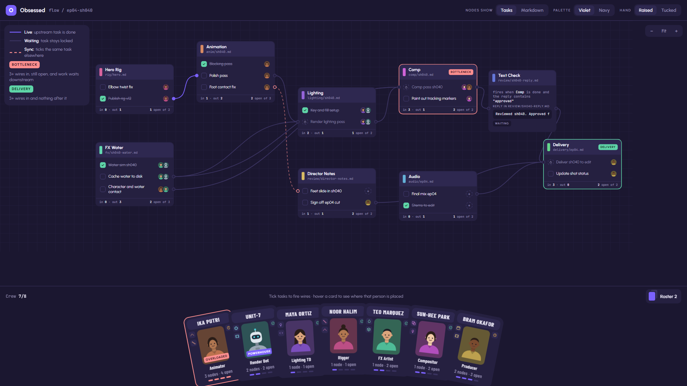
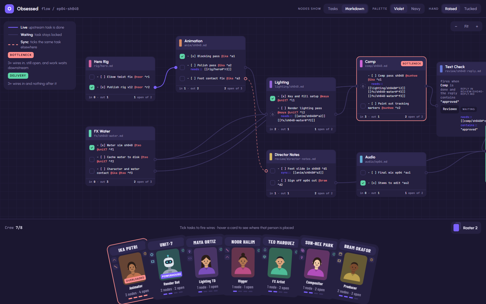
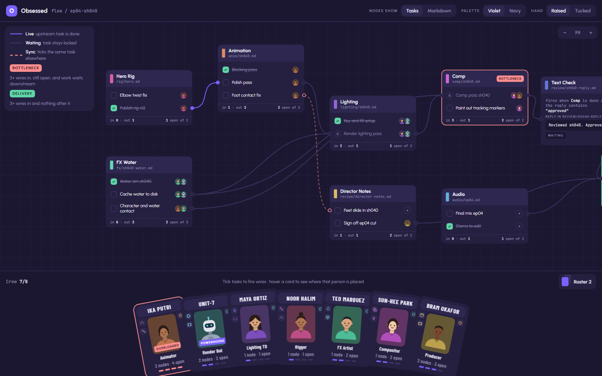
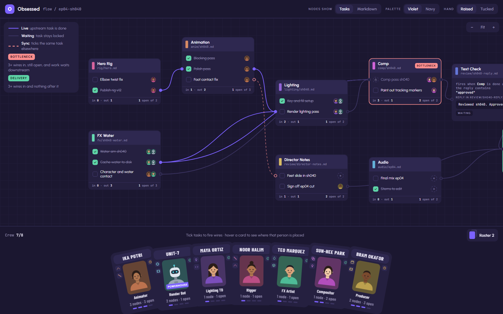
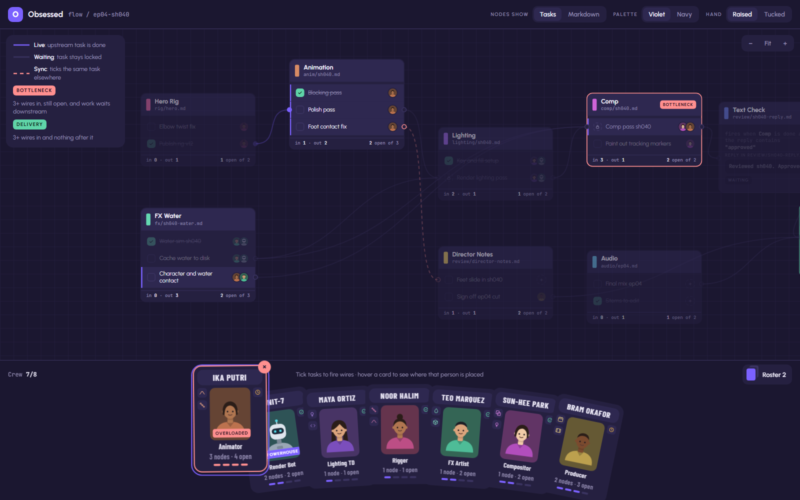
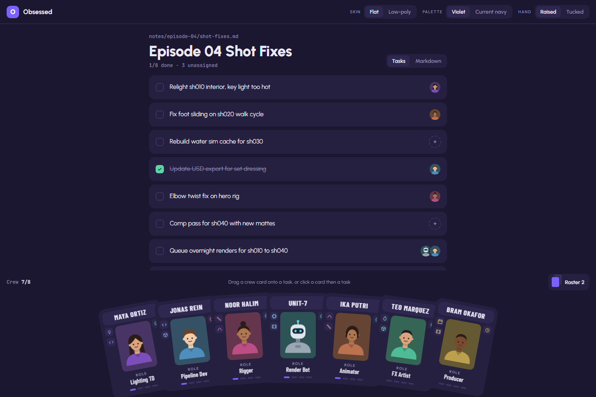
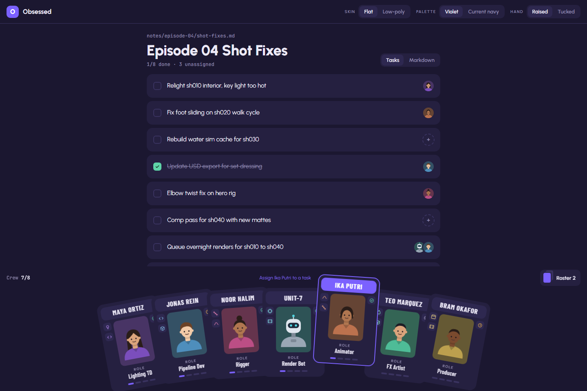
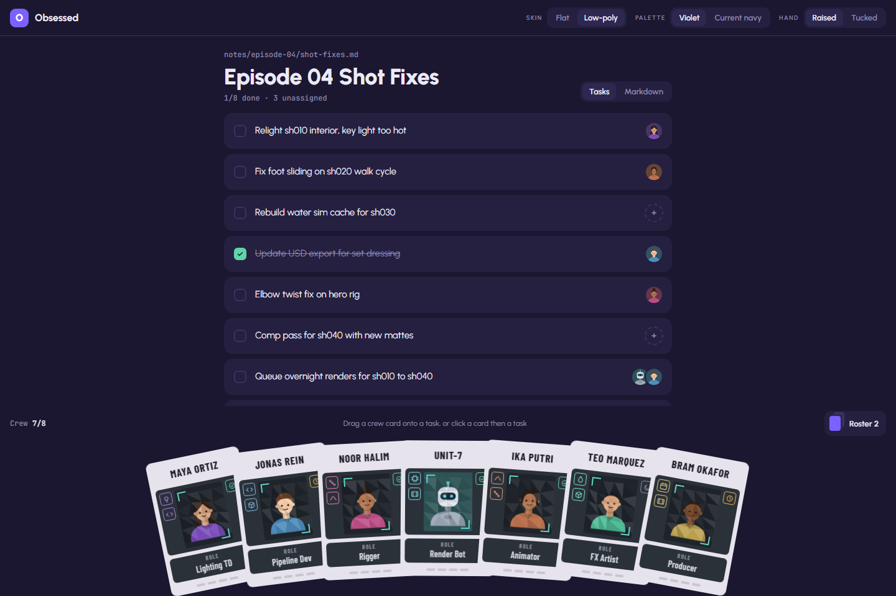
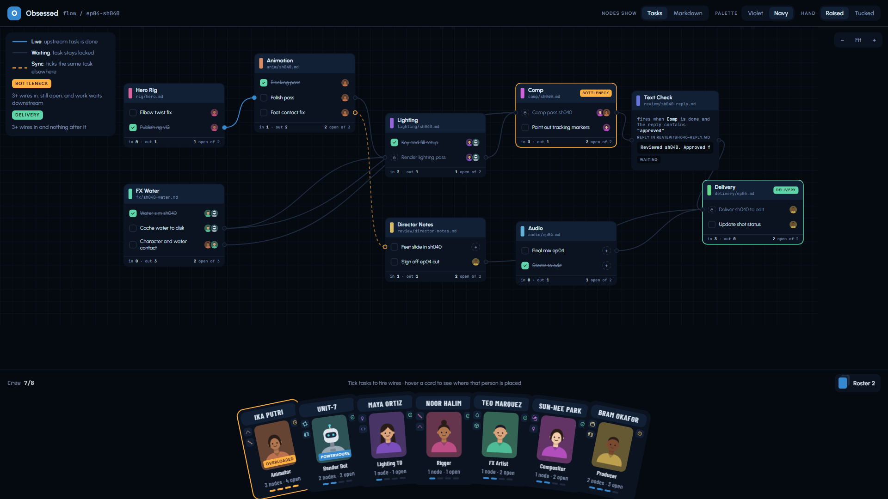

# Obsessed – Plan

A markdown task app for creative teams, built in Godot.

Like Obsidian, your notes are plain `.md` files in a folder. What's different is the **node graph**: every `.md` file is a node, every task is a row with pins, and wires carry status between files the way a studio pipeline does. When animation marks a shot approved, lighting's task for that shot becomes ready to start, by itself.

On top of that sits a **card layer** inspired by Balatro: tasks are the enemies, and your hand holds crew cards and tool cards.

> Updated 2026-10-15. Replaces the old `Project-Plan.md` and `Detailed-Plan.md`.

## Ground rules

1. **The files are the truth.** Everything the app knows is written in plain markdown, following [SYNTAX.md](SYNTAX.md). The graph and the cards are views of those files. Close the app and the vault still makes sense in Obsidian.
2. **Desktop first, web later.** It's one Godot project. The UI only talks to a `Vault` interface, so web mode means adding a second implementation, not rewriting the app.
3. **This is a learning project.** All GDScript and scenes are written by hand. AI help is for planning, explaining and reviewing.
4. **The game layer sits on top.** Every card play becomes an ordinary markdown change, so turning cards off loses nothing.

## The screens

> These images are rendered from the HTML mockups in `docs/mockups/`. They're early ideation, so details will change. To regenerate them after editing a mockup, run `bash docs/mockups/render-screens.sh` in Git Bash.

### Flow view

The main idea: every `.md` file is a node, every task is a row, and wires show what waits on what.



| Piece | What it does | Godot to look at |
|---|---|---|
| Top bar | App name, the current flow, and toggles for node content (Tasks / Markdown), palette, and hand raised or tucked. | `HBoxContainer`; `Button` with `toggle_mode` and a `ButtonGroup` for each set of toggles |
| Canvas | Pan, zoom, and a grid behind the nodes. | `GraphEdit` (panning, zoom, grid, snapping and a minimap are built in) |
| Legend | Explains the wire colors and the pills. | `PanelContainer` + `VBoxContainer` + `Label` |
| Zoom − Fit + | Zoom out, fit everything on screen, zoom in. | `GraphEdit`'s built-in menu has zoom buttons. "Fit" is your own math on `zoom` and `scroll_offset`. |
| File node | One `.md` file. The color strip is the department, followed by the title and file path. | `GraphNode`. Add extra things to its title bar with `get_titlebar_hbox()`. |
| Pill | BOTTLENECK: 3+ wires in, still open, work waiting downstream. DELIVERY: 3+ wires in, nothing after it. | `Label` with a `StyleBoxFlat` (rounded corners, background color) |
| Task row | Status box, task text, people. | `HBoxContainer` inside the `GraphNode` |
| Pins | The dots on a row's left (in) and right (out) edges. | `GraphNode.set_slot()` turns a row's edges into ports |
| Wires | Solid purple = live (upstream done). Grey = waiting. Dashed pink = `sync::`. | `GraphEdit` connections, colored by their slots. Dashed lines aren't built in: draw sync wires yourself or give them their own color. |
| Node footer | `in 3 · out 1` and `2 open of 2`. | `Label`, updated whenever the file changes |
| Text Check | The first operator node. It fires when comp is done and the reply note contains "approved". | Another `GraphNode`, with a `LineEdit` inside |
| Crew hand | Cards along the bottom. See [Card hand](#card-hand). | |

### A file as a node

The **Markdown** toggle shows the same nodes as the plain text that's really in each file. It's ground rule 1 in one picture: the graph is only a view of the markdown.



> The mockups were made before [`::statusformat::`](SYNTAX.md#2-status-format). Real nodes will show each file's own symbols (⚪ 🔳 ❓ ✅ …) instead of a plain checkbox and lock.

### Firing wires

This is the vertical slice from milestone 4. Ticking *Polish pass* (anim) and *Cache water to disk* (fx) makes their wires go live, and *Render lighting pass* (lighting) unlocks: its lock icon is gone in the "after" picture.

| Before | After |
|---|---|
|  |  |

In the real app the file changes too. `lighting/sh040.md` goes from `- [-] Render lighting pass` to `- [ ] Render lighting pass`, so ⚪ becomes 🔳.

### Crew spotlight

Hovering a crew card dims every task that person isn't on, so you can see at a glance how spread out someone is. Ika has 4 open tasks across 3 files, so her card says OVERLOADED.



Godot: lower the `modulate` alpha of the rows and nodes that don't match.

### Card hand

This is the single-note view: one file's tasks in the middle and the crew hand at the bottom. Click a card to pick it up (it rises and the hint changes to "Assign Ika Putri to a task"), then click a task, or drag the card onto a task. The assignment is saved as `@ika` on the task line.

| Hand | Card picked up |
|---|---|
|  |  |

| Piece | What it does | Godot to look at |
|---|---|---|
| Hand | Cards fanned in a slight arc. "Tucked" slides them mostly off screen until you hover. | A plain `Control` that places each card in code (position, rotation). Containers can't make a fan. |
| Card | Name, skill chips, portrait, status (available, busy or away), role, load pips. | `PanelContainer` + `VBoxContainer`, a `TextureRect` for the portrait, small `Panel`s for the pips |
| Load pips | One lit pip per open task, up to 4. They turn pink when the card is OVERLOADED. | |
| Hover | The card rises, straightens and tilts toward the mouse. | `Tween` on `position`, `rotation` and `scale`. The 3D tilt needs a shader. |
| Idle bob | Cards float gently. | A looping `Tween` or an `AnimationPlayer` |
| Drag onto a task | Assigns the person. | `_get_drag_data()` + `set_drag_preview()` on the card; `_can_drop_data()` + `_drop_data()` on the task row |
| Roster button | Draws another card from the roster. The hand holds at most 8. | `Button` |
| × on a card | Sends the card back to the roster. | |

### Skins and palettes

| Low-poly card skin | Navy palette |
|---|---|
|  |  |

Godot: each palette is a `Theme` resource that you can swap at runtime. A second card skin can be its own card scene or a theme variation.

### Not in the mockups yet

These parts of the idea don't have a picture yet. They're worth sketching before their milestone starts:

- **The main layout:** the file tree on the left (like Obsidian), the editor, and how you switch between the editor, the graph and the card view. (Milestone 2)
- **Emoji statuses:** rows drawing each file's own `::statusformat::` symbols, plus ⚠ for an unknown status and a warning badge when a status disagrees with its `needs::`. (Milestones 3 to 5)
- **What a file node shows besides tasks:** headings, notes and other text in the file. (Milestone 4)
- **The log and undo panel:** the list of changes wires have made. (Milestone 5)
- **More operator nodes:** Find & Replace, Set Status, Append Line. (Milestone 6)
- **The Balatro layer:** enemies with HP, a Jokers row for always-on automations, boss blinds. (Milestone 7 onwards)

## Tech

| Part | Choice |
|---|---|
| Engine | Godot 4.7, GDScript, Compatibility renderer (web export needs it) |
| Desktop file access | `FileAccess` and `DirAccess`. No server, no Python. |
| Web mode server | Python + FastAPI (milestone 9 only) |
| Hosting | One Docker container (milestone 9 only) |

## Architecture

```
                 ┌─ LocalVault  → FileAccess / DirAccess                      desktop .exe
Views ─► Vault ──┤
   ▲             └─ RemoteVault → HTTPRequest → FastAPI → vault/ on server    web export
   │
   └── Parser + Wire engine   (logic only, no UI nodes)
```

| Piece | Job |
|---|---|
| `Vault` | List, read, write and delete files. Later: notice when files change. |
| `LocalVault` | Reads the folder on disk directly. Used by the desktop app. |
| `RemoteVault` | Asks the server over HTTP. Used by the web export, because browsers can't touch the disk. |
| Parser | Turns a `.md` file into tasks and writes single-line changes back. |
| Wire engine | Works out `needs::` and `sync::`, runs chain reactions, guards against loops, keeps the log and undo. |
| Views | File tree, editor, graph and card hand. They show what the parser and engine know, and ask the `Vault` to save changes. |

The parser and wire engine contain no UI nodes. That means you can test them on their own, and web mode can reuse them unchanged. In Unreal terms, `Vault` is an interface with two implementations.

## Repo layout

```
Obsessed/
├─ project.godot      # the Godot project lives at the repo root
├─ PLAN.md            # this file
├─ SYNTAX.md          # the markdown rules (the contract)
├─ sample-vault/      # test notes to develop against
├─ docs/
│  ├─ mockups/        # HTML ideation mockups (look and feel only) + render-screens.sh
│  └─ images/         # PNGs of the mockups, shown in this plan
└─ backend/           # FastAPI server, added in milestone 9
```

How you organise scripts and scenes is up to you. The Godot docs suggest grouping by feature, with each scene and its script side by side (for example `graph/file_node.tscn` next to `graph/file_node.gd`), instead of separate `scenes/` and `scripts/` folders.

## Milestones

Each milestone has a "done when" so you know when to move on.

### 1. Prep (done 2026-10-15)

PLAN.md, SYNTAX.md, sample-vault and the mockups are all in the repo.

### 2. Files

Goal: browse and edit the vault.

**Looks like:** not mocked up yet. See [Not in the mockups yet](#not-in-the-mockups-yet).

- **First:** open the project in Godot 4.7 and let it upgrade `project.godot`.
- Main layout: file tree on the left, editor on the right.
- Decide about the borderless window (`window/size/borderless` is currently on). Keeping it means building your own title bar, dragging and resizing.
- Check emoji rendering early. A browser has no system fonts, so bundle a color emoji font (for example Noto Color Emoji) as a fallback font in your Theme.
- **Learn:** containers (`HSplitContainer`, `VBoxContainer`), `Tree`, `TextEdit`/`CodeEdit`, `FileDialog`, `FileAccess`, `DirAccess`, signals, Themes.
- **Done when:** you can pick `sample-vault/`, see its folders in the tree, open `anim/sh040.md`, edit and save it, and see the change in another editor. The emoji show in color.

### 3. Task parser

Goal: turn a `.md` file into task data, and back again.

- Read tasks, the status format, `@people`, `^ids`, `needs::` and `sync::` as described in SYNTAX.md.
- Change one task's status and write the file back with every other character untouched.
- **Learn:** `RegEx`, `String` methods, your own classes (`class_name`, `RefCounted`), Arrays and Dictionaries, unit tests (the GUT or gdUnit4 addon).
- **Done when:** every file in `sample-vault/_parser-tests/` gives the result its "Expected" note describes, and reading then writing a file without changes gives back exactly the same bytes.

### 4. Vertical slice ⭐

Goal: prove the core idea works.

**Looks like:** [Firing wires](#firing-wires).

- A `GraphEdit` canvas. Each `.md` file is a `GraphNode` and each task is a row with ports.
- Draw the `needs::` wires the files describe.
- Ticking a task unblocks the tasks downstream of it, and the change is saved to disk.
- **Learn:** `GraphEdit`, `GraphNode` slots (`set_slot`), the `connection_request` signal, building UI from code.
- **Done when:** in the sample vault, ticking *Polish pass* (anim) and *Cache water to disk* (fx) flips *Render lighting pass* from ⚪ to 🔳, both in the graph and in `lighting/sh040.md`.

### 5. Wire engine

**Looks like:** [Flow view](#flow-view).

- `sync::` wires, custom statuses, clicking and right-click to change status, chain reactions, loop guard, log and undo.
- Drawing a wire in the graph writes `needs::` or `sync::` into the file, and adds a `^id` if the task doesn't have one.
- Notice edits made outside the app by checking `FileAccess.get_modified_time()`.
- **Done when:** the whole sh040 chain can be pushed from rig to delivery in the graph, undo works, and editing a file in Obsidian or VS Code updates the graph.

### 6. Operator nodes

**Looks like:** the Text Check node in [Flow view](#flow-view).

- Nodes that aren't files: Text Check, Find & Replace, Set Status, Append Line, and so on.
- Design the `.obsessed/` JSON format for node positions and operator nodes.
- **Done when:** the mockup's Text Check works. *Deliver sh040 to edit* only unlocks once comp is approved and `review/sh040-reply.md` contains "approved".

### 7. Cards

**Looks like:** [Card hand](#card-hand) and [Crew spotlight](#crew-spotlight).

- A hand of crew cards (people and bots) and tool cards. Dragging a crew card onto a task writes `@name` into it.
- Decide where the crew list lives.
- **Learn:** Control drag and drop (`_get_drag_data`, `_can_drop_data`, `_drop_data`), `Tween`, shaders for card juice.
- **Done when:** the hand from `docs/mockups/obsessed-hand.html` works on real files.

### 8. Preview and polish

**Looks like:** [Skins and palettes](#skins-and-palettes).

- Turn markdown into BBCode for a `RichTextLabel` preview. It can't show HTML.
- Themes (the violet and navy palettes from the mockups) and keyboard shortcuts.

### 9. Web mode

- `RemoteVault` using `HTTPRequest`, the FastAPI backend, the web export, and one Docker container for hosting.
- Later: live updates between users (Godot has `WebSocketPeer`) and a login token.

## Web mode notes

Browsers can't read or write files on the user's disk. So in web mode the vault lives on the server, and the browser asks the server to read and write files. If you run the server on your PC, every device on your network edits your PC's vault. That's also what a studio needs: one shared vault.

Server API sketch, tidied up from the old plans:

| Method | Path | Does |
|---|---|---|
| GET | `/api/tree` | List folders and files |
| GET | `/api/file?path=` | Read a file |
| PUT | `/api/file?path=` | Create or overwrite a file |
| DELETE | `/api/file?path=` | Delete a file |

- The same server also serves the Godot web export as static files, so one address does both.
- The server must refuse any path outside the vault, like `../../secret`.
- Godot never starts the server itself. Run it with `uvicorn` while developing and with Docker when hosted. (`OS.execute()` would freeze the app anyway, because it waits for the program to finish and a server never does.)
- Only use Docker when hosting on another machine (a VPS, home server or NAS): one container, with the vault folder mounted as a volume so notes survive rebuilds.
- Godot 4.3 and later can export the web build without thread support, which avoids the special COOP/COEP server headers that threaded builds need.
- To decide at the start of milestone 9: when two people edit the same file, who wins? And does the wire engine run in each browser or on the server?

## Hard problems to plan for early

1. **Safe one-line edits.** When a wire ticks a task in another file, change only that line.
2. **Loops.** A ticks B and B ticks A. See the loop guard in SYNTAX.md section 6.
3. **Undo and a log.** Automations quietly changing other files is scary, so every change has to be visible and undoable.
4. **Outside edits.** Obsidian, VS Code or `git pull` can change files while the app is open.
5. **Many users** (web mode). Two people saving the same file.
6. **Emoji fonts.** The web export has no system fonts to fall back on.

## Card layer ideas

| Balatro | Obsessed |
|---|---|
| Blind / enemy | A `.md` file or task. Its HP is its open tasks. |
| Boss blind | A milestone or deadline with a special rule |
| Playing cards | Crew (people and bots) and tool cards (Find & Replace, Set Status) |
| Jokers | Always-on automations ("any anim shot approved → unlock lighting") |
| Deck | The full roster and all tools |

Reward the *flow* (shots cleared, bottlenecks broken), not individual people. Ranking people in a team tool turns sour fast. The mockup's OVERLOADED tag is the good kind, because it protects people.

## Decisions

| Date | Decision |
|---|---|
| 2026-10-15 | The app is called **Obsessed**. "PossessApp" in the early mockups was a placeholder. |
| 2026-10-15 | Godot 4.7. |
| 2026-10-15 | Desktop first. Web mode comes later through the `Vault` interface, and FastAPI is only for web mode. |
| 2026-10-15 | Docker only for hosting. |
| 2026-10-15 | Wires live in the `.md` files (`needs::`, `sync::`, `^id`). Data that isn't a task goes in `.obsessed/` as JSON. |
| 2026-10-15 | Each file can set its own statuses and emoji with `::statusformat::`. One format per file, and the last one wins. |

## Open questions

- The fixed meanings of `[ ]`, `[x]` and `[-]` (SYNTAX.md section 2): confirm.
- Unblocking, retakes and clicking (SYNTAX.md section 6): confirm.
- Borderless window: keep it, or turn it off for now? (milestone 2)
- Main layout: how do you switch between the editor, the graph and the card view? (milestone 2)
- What a file node shows besides its tasks (milestone 4).
- Where the crew list lives (milestone 7).
- Several users and where the wire engine runs (milestone 9).
